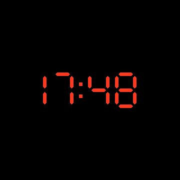
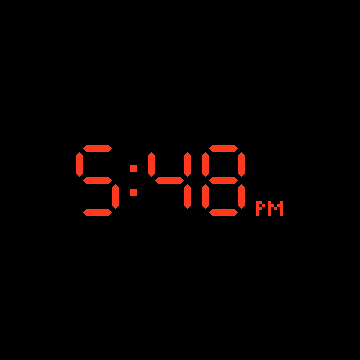

# tv-led

v1.1.0 · Forerunner 265S · [返回表盘目录](../)

Forerunner 265S 的七段 LED 表盘。纯黑底上只有一行时间，数字由三条横段和四条竖段组合而成，默认使用 70 年代电子表的红色。时间制式跟随手表。

## 预览

同一个下午，左图是 24 小时制的 `17:48`，右图是 12 小时制的 `5:48 PM`。两张图都使用 265S 模拟器和相同的固定示例时间。

 

265S 的系统数字字体为 Roboto。这款表盘使用专用七段字模，横段共用三条水平轴，左右竖段的端点对齐，接缝处留黑。亮屏数字的字框为 43 × 71 像素，相邻数字的字框之间留 11 像素，时间按整行实际亮起的笔画居中。[系统字体对照图](system-font.png) · [Garmin 265S 字体清单](https://developer.garmin.com/connect-iq/device-reference/fr265s/)

## 安装与更新

1. 下载 [TVLED.prg](https://github.com/thetvplus/tv-watchface/releases/download/tv-led-v1.1.0/TVLED.prg)，通过 USB 连接手表。
2. 将文件复制到 `Internal Storage/GARMIN/Apps`。更新时替换同名文件即可保留设置。
3. 断开 USB，在时间页长按 UP，进入「表盘」，选择 **tv-led** 并应用。

## 表盘设置

在手表的表盘「设置」里可以调整以下四项。菜单支持简体中文、繁體中文和 English。

| 设置 | 选项 |
| --- | --- |
| 时间颜色 | 默认为 LED 红 `FF3924`。可选琥珀、磷光绿、柔白，或输入任意六位 HEX 色值，例如 `#38BDF8`。常亮沿用该色并降低亮度。 |
| 数字大小 | 大 100%（默认，与上一版相同）、中 80%、小 60%。 |
| 数字高度比例 | 默认 100%、拉伸 125%、压缩 75%，或输入 50–150 的整数百分比。高度相对所选大小，宽度独立。 |
| 亮屏校时频率 | 默认换分时校时。可选每 3 秒、每秒，或输入 1–60 的整数秒数。抬腕立即校时，所有档位都会检查换分边界。 |

12／24 小时制在手表系统中切换。24 小时制保留小时的前导零，12 小时制将小号 AM／PM 和数字作为一行居中。

从本页经 USB 安装后，请在手表菜单选择预设或输入自定义 HEX。项目另提供 Connect IQ 商店分发所需的手机设置资源，两端共用色值校验。[Garmin 设置说明](https://forums.garmin.com/developer/connect-iq/w/wiki/4/new-developer-faq#app-settings)

## 显示与功耗

表盘使用系统显示回调。在支持设置通知的固件上，通过回调更新制式。亮屏时复用当前分钟的时间文字和位置，默认尺寸直接绘制七段字模，自定义布局在换分时生成缩放图，同一分钟的后续亮屏回调直接复用。冒号保持常亮，传感器、后台任务和自建定时器的调用均为零。关屏时直接返回。

常亮使用系统的分钟回调，默认大小和比例切换到 29 × 45 像素的七段字模，奇偶分钟交替点亮不同扫描行。在默认大小和比例下遍历 12／24 小时制的全天画面，最满的一帧点亮 1,006 个像素，约占圆屏的 0.99%。相邻分钟的亮点没有重合，包含跨午夜的一帧。自定义布局在缩放之后叠加棋盘遮罩，每分钟交换明暗像素，保留压缩后的细横段。265S 模拟器实拍“大 × 150%”相邻两分钟亮点零重合。最小档叠加最大压缩时，AM／PM 较细。实际续航还需实表测量。[常亮截图](preview-aod.png) · [Garmin AMOLED 表盘指南](https://developer.garmin.com/connect-iq/articles/user-experience-guidelines/Watch_Faces.html)

## 构建与验证

字模随项目提供。在本目录运行 `python tools/make_fonts.py` 可重新生成字模。发布前用本地验证工具核对亮屏截图、常亮面积及跨分钟像素轮换。模拟器测试另覆盖菜单顺序、HEX 输入和校时间隔。[构建与测试命令](../DEVELOPMENT.md)
