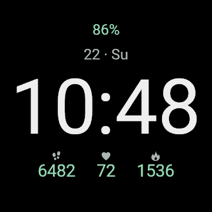

# tv Minimal

v1.0.1 · Forerunner 265S · [返回表盘目录](../)

Garmin Forerunner 265S 的黑底表盘。中央显示时间，上方显示电量和日期，下方依次为步数、心率和当日千卡。支持简体中文、繁體中文和 English，跟随手表的 12／24 小时制。

## 预览

 

## 安装与更新

1. 下载 [TVMIN.prg](https://github.com/thetvplus/tv-watchface/releases/latest/download/TVMIN.prg)，通过 USB 连接手表。
2. 将文件复制到手表的 `Internal Storage/GARMIN/Apps`。更新时选择替换同名文件，保留已有设置。
3. 传输完成后断开 USB。首次安装时，在时间页长按 UP，进入「表盘」，选择 **tv Minimal** 并应用。

## 表盘设置

在手表的表盘「设置」里调整，菜单随手表语言切换。时间制式跟随系统。

| 设置 | 选项 |
| --- | --- |
| 时间颜色 | 12 个预设色，默认柔白。 |
| 数据颜色 | 同一组 12 色，默认薄荷绿。系统橙为 `#FF5500`，暖橙为 `#FF9500`。 |
| 电量显示 | 百分比（默认）或电池图标。 |
| 亮屏校时频率 | 换分时（默认）、每 3 秒或每秒。三个档位都检查换分边界。 |
| 活动数据与电量 | 每 1、5（默认）或 15 分钟刷新步数、千卡和电量。 |
| 仅抬腕读取心率 | 默认关闭，亮屏最多每 3 秒读取。开启后本次亮屏保留首个有效值。 |

## 显示与功耗

亮屏时长、抬腕手势和常亮由手表的「系统 → 显示 → 日常使用」控制。亮屏时复用含时间和所有读数的 360 × 284 像素内容区。心率变化只擦写心率单元格，步数和千卡变化时才更新数字和字号。常亮时仅显示调暗的时间，每分钟轮换点亮的像素，暂停读取活动数据和电量。关屏时直接返回。

## 构建与验证

发布目标为 SDK 9.3.0 的 `fr265s`。测试覆盖手表菜单顺序、Storage 设置生效、制式切换和换分边界。[构建与测试命令](../DEVELOPMENT.md) · [布局与功耗评估](构建与功耗评估.md)
