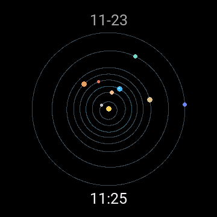
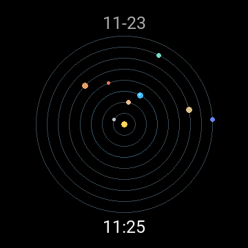

# tv-orbit

v1.1.1 · Forerunner 265S · [返回表盘目录](../)

Forerunner 265S 的太阳系表盘。太阳位于圆屏正中心，八颗行星各有一条轨道。表缘上方显示本地月日，下方用 Garmin 系统小字显示时间，12 小时制的 AM／PM 随时间一起居中。

## 预览

265S 模拟器，2026 年 11 月 23 日台北时间 11:25。下图依次为**内圈放大**、**近似实距**、**均衡分布**和**同心圆**。

   

地球用带高光的亮蓝圆点标示，第三条轨道带有淡蓝色。同心圆每 16 像素一圈，行星仍按日心方向沿各自圆环移动。月日与时分沿表缘居中。[12 小时制截图](preview-12h.png)

## 真实距离对照

下表使用独立星历在 **2026-11-22 12:00 UTC** 的位置。「日心距离」为空间距离，四列像素是同一位置投影后到表心的距离，均在取整前计算。表盘按 JPL 的近似轨道根数计算八颗行星，地球用地月质心近似。[JPL 轨道根数与算法](https://ssd.jpl.nasa.gov/planets/approx_pos.html) · [对照星历 Astronomy Engine](https://github.com/cosinekitty/astronomy)

| 行星 | 日心距离（AU） | 内圈放大（像素） | 近似实距（像素） | 均衡分布（像素） | 同心圆（像素） |
| --- | ---: | ---: | ---: | ---: | ---: |
| 水星 | 0.347 | 15.85 | 13.10 | 13.10 | 16.00 |
| 金星 | 0.720 | 33.14 | 27.38 | 27.38 | 32.00 |
| 地球 | 0.988 | 45.43 | 37.53 | 37.53 | 48.00 |
| 火星 | 1.616 | 58.49 | 47.81 | 49.87 | 64.00 |
| 木星 | 5.324 | 86.70 | 58.10 | 71.99 | 80.00 |
| 土星 | 9.419 | 100.18 | 69.45 | 87.66 | 96.00 |
| 天王星 | 19.432 | 117.33 | 97.27 | 111.53 | 112.00 |
| 海王星 | 29.877 | 127.51 | 126.25 | 127.22 | 128.00 |

四种模式都从黄道北侧俯视，J2000 黄经零度朝右，黄经逆时针增加。内圈放大在 1.05 AU 内用 46 像素／AU，外侧按对数压缩。近似实距和均衡分布在 1.23 AU 内都用 38 像素／AU，外侧分别用线性和对数映射。前三种模式都将 30.5 AU 映射到 128 像素。圆点大小用于辨认行星。

## 安装与更新

下载 [TVORBIT.prg](https://github.com/thetvplus/tv-watchface/releases/download/tv-orbit-v1.1.1/TVORBIT.prg)。

[USB 安装](../README.md#install) · [覆盖更新](../README.md#update) · [卸载](../README.md#uninstall)

## 表盘设置

| 设置 | 选项 |
| --- | --- |
| 时间制式 | 默认跟随手表，也可固定 12 或 24 小时制。24 小时制保留小时的前导零。 |
| 时间颜色 | 默认为白色，可选琥珀、天蓝、柔绿，或输入任意六位 HEX 色值，例如 `#D6A35F`。常亮沿用所选颜色并调暗。 |
| 轨道比例 | 内圈放大（默认）、近似实距、均衡分布、同心圆。 |
| 轨道更新 | 每天、每 2 天（默认）、每 3 天。 |

手表菜单支持简体中文、繁體中文和 English。USB 安装可在手表上修改全部设置。项目也提供 Connect IQ 商店分发所需的手机设置资源。[Garmin 设置说明](https://forums.garmin.com/developer/connect-iq/w/wiki/4/new-developer-faq#app-settings)

## 位置更新与功耗

星图在首次亮屏时生成。每次重算取当前 UTC 更新时段的中点，时段内换分或再次抬腕都复用星图。超过更新边界后，星图在下一次亮屏绘制时更新。变更比例或更新间隔也会重建星图。底图离线预绘，常亮只画调暗的时间，关屏直接返回。[常亮截图](preview-aod.png) · [Garmin AMOLED 指南](https://developer.garmin.com/connect-iq/articles/user-experience-guidelines/Watch_Faces.html)

用 Astronomy Engine 2.1.19 对照 2024–2031 年八颗行星，每三小时取样。表中为各模式下取整前的最大平面偏差，均出现在水星。

| 更新间隔 | 内圈放大（像素） | 近似实距（像素） | 均衡分布（像素） | 同心圆（像素） |
| --- | ---: | ---: | ---: | ---: |
| 每天 | 0.78 | 0.65 | 0.65 | 0.89 |
| 每 2 天 | 1.56 | 1.29 | 1.29 | 1.77 |
| 每 3 天 | 2.34 | 1.93 | 1.93 | 2.65 |

每 2 天比每天少一半定期重算，四种比例的最大偏差均低于 2 像素。实表续航仍待佩戴测量。

### 安装包与绘制开销

同一套四种轨道样式的本地 PRG 从 102,508 字节减至 33,916 字节，缩小 66.9%。轨道底图使用编译器的资源压缩。亮屏复用已合成的星图，按原来的节奏校时。行星求解采用 JPL 给出的初值，两次迭代即可达到表盘所需精度。四种模式的更新偏差取整到千分之一像素后与优化前一致。[Garmin 资源编译说明](https://developer.garmin.com/connect-iq/articles/core-topics/Resources.html) · [JPL 迭代初值](https://ssd.jpl.nasa.gov/planets/approx_pos.html)

常亮遮罩从 360 × 72 缩至 192 × 56 像素，面积减少 58.5%，首次常亮时加载。265S 模拟器测试遍历了全天两种时间制式，最大文字宽度为 158 像素。各重复测试绘制 36 次常亮文字和遮罩，五次耗时的中位数约由 203 ms 降至 156 ms。交替运行优化前后的亮屏测试，各 50 帧的中位耗时均约 610 ms。模拟器截图的亮屏和常亮画面逐像素一致。

## 构建与验证

Connect IQ SDK 9.3.0，目标设备 `fr265s`。模拟器验证了四种比例、三种菜单语言、UTC 更新边界、12／24 小时制及亮屏、常亮和关屏。用同一开发签名覆盖安装后，旧版选择的「线性实距」正确对应到「近似实距」。取样核对 2000–2050 年的轨道轮廓，四种模式下地球距离表心最少约 37 像素，太阳和相邻行星标记之间最窄仍有约 1.9 像素空隙（取整前）。[构建与性能评估](../DEVELOPMENT.md)
