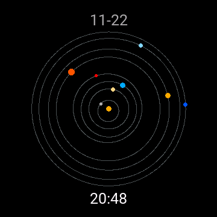
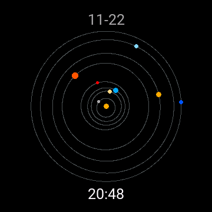

# tv-orbit

v1.0.0 · Forerunner 265S · [返回表盘目录](../)

Forerunner 265S 的太阳系表盘。太阳位于圆屏正中心，八颗行星各有一条轨道。表缘上方显示本地月日，下方用 Garmin 系统小字显示时间，12 小时制的 AM／PM 随时间一起居中。

## 预览

265S 模拟器，2026 年 11 月 22 日台北时间 20:48。下图依次是默认的**内圈优先**、**线性实距**和**对数距离**。三张图对应同一时刻。

  

默认模式给太阳到地球的区域更多空间。1.05 AU 内每 AU 占 46 像素，水星、金星和地球保持相互的投影比例。再往外逐渐压缩到海王星，八个圆点即使处于同一方向也能分开。地球是第三轨道上的亮蓝圆点。月日与时分沿表缘居中，留出中央星图。[12 小时制截图](preview-12h.png)

## 真实距离对照

下表使用独立星历在 **2026-11-22 12:00 UTC** 的位置。「日心距离」为空间距离，三列像素是同一位置投影后到表心的距离，均在取整前计算。表盘按 JPL 的近似轨道根数计算八颗行星，地球用地月质心近似。[JPL 轨道根数与算法](https://ssd.jpl.nasa.gov/planets/approx_pos.html) · [对照星历 Astronomy Engine](https://github.com/cosinekitty/astronomy)

| 行星 | 日心距离（AU） | 内圈优先（像素） | 线性实距（像素） | 对数距离（像素） |
| --- | ---: | ---: | ---: | ---: |
| 水星 | 0.347 | 15.85 | 1.45 | 14.72 |
| 金星 | 0.720 | 33.14 | 3.02 | 25.57 |
| 地球 | 0.988 | 45.43 | 4.15 | 31.55 |
| 火星 | 1.616 | 58.49 | 6.78 | 42.35 |
| 木星 | 5.324 | 86.70 | 22.34 | 74.24 |
| 土星 | 9.419 | 100.18 | 39.49 | 91.25 |
| 天王星 | 19.432 | 117.33 | 81.55 | 113.74 |
| 海王星 | 29.877 | 127.51 | 125.35 | 127.34 |

三种模式都从黄道北侧俯视，J2000 黄经零度朝右，黄经逆时针增加。30.5 AU 在每种模式下都对应 128 像素。线性视图每像素对应约 0.238 AU，可直接比较平面距离。对数视图按同一条曲线展开各条轨道。圆点大小用于辨认行星。线性实距下内行星会靠拢或重叠。

## 安装与更新

1. 下载 [TVORBIT.prg](https://github.com/thetvplus/tv-watchface/releases/download/tv-orbit-v1.0.0/TVORBIT.prg)，通过 USB 连接手表。
2. 将文件复制到 `Internal Storage/GARMIN/Apps`。更新时替换同名文件以保留设置。
3. 断开 USB，在时间页长按 UP，进入「表盘」，选择 **tv-orbit** 并应用。

## 表盘设置

| 设置 | 选项 |
| --- | --- |
| 时间制式 | 默认跟随手表，也可固定 12 或 24 小时制。24 小时制保留小时的前导零。 |
| 时间颜色 | 默认为白色，可选琥珀、天蓝、柔绿，或输入任意六位 HEX 色值，例如 `#D6A35F`。常亮沿用所选颜色并调暗。 |
| 轨道比例 | 默认内圈优先。线性实距可核对平面距离，对数距离可查看统一压缩后的全图。 |

手表菜单支持简体中文、繁體中文和 English。USB 安装可在手表上修改全部设置。项目也提供 Connect IQ 商店分发所需的手机设置资源。[Garmin 设置说明](https://forums.garmin.com/developer/connect-iq/w/wiki/4/new-developer-faq#app-settings)

## 位置更新与功耗

每天第一次亮屏时计算该 UTC 日正午的八颗行星位置，并缓存星图。再次抬腕或换分时复用缓存，重启表盘或更改比例后在下一次亮屏重建。八条轨道轮廓用 2026 年初的轨道根数预绘，手表只需叠上当日行星。常亮只画调暗的时间，奇偶分钟交替点亮不同像素行。关屏直接返回，无需定位、联网或后台计时。[常亮截图](preview-aod.png) · [Garmin AMOLED 指南](https://developer.garmin.com/connect-iq/articles/user-experience-guidelines/Watch_Faces.html)

用 Astronomy Engine 2.1.19 对照 2024–2031 年八颗行星，每三小时取样。每日正午位置与各时刻参考位置的最大距离，默认视图为 **0.781 像素**，线性为 **0.076 像素**，对数为 **0.741 像素**。若两天才计算一次，默认视图中水星的偏差可达 **1.559 像素**。这些数值衡量取整前的平面位置偏差。实表续航仍待佩戴测量。

## 构建与验证

Connect IQ SDK 9.3.0，目标设备 `fr265s`。模拟器测试用 2000、2020 和 2026 年三个日期的独立日心坐标验证三种比例和缓存的日期边界。检查脚本还逐年对照 2000–2050 年的轨道轮廓取样点与发货位图，允许一个像素的栅格化差异。默认模式另按逐年轨道径向范围对照，太阳和相邻行星标记之间最窄仍有约 2 像素空隙（取整前）。[构建与性能评估](../DEVELOPMENT.md)
