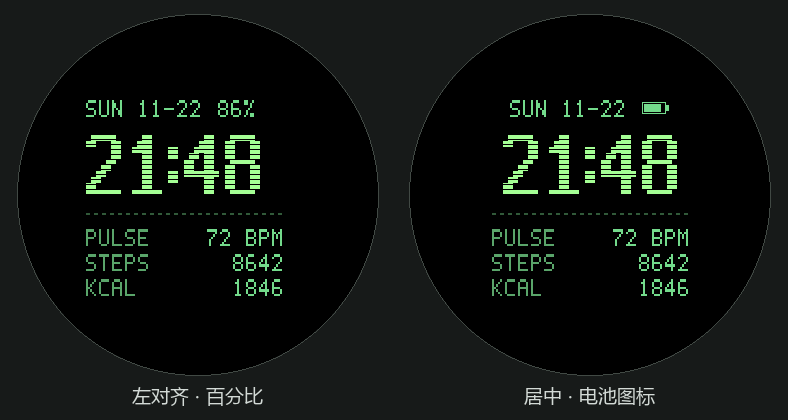

# tv-terminal

v1.0.1 · Forerunner 265S · [返回表盘目录](../)

Forerunner 265S 的 80 年代终端表盘。时间用带扫描线的点阵数字，日期、电量和读数用实心等宽字。

## 预览

同一时刻 `21:48`，左图为左对齐和电量百分比，右图为居中和电池图标。两图均来自 265S 模拟器。

[电量两种样式](preview-battery.png) · [12 小时制布局](preview-12h.png) · [265S 系统字体对照](font-comparison.png) · [常亮模拟器截图](preview-aod.png)

## 安装与更新

1. 下载 [TVTERM.prg](https://github.com/thetvplus/tv-watchface/releases/download/tv-terminal-v1.0.1/TVTERM.prg)，通过 USB 连接手表。
2. 将文件复制到手表的 `Internal Storage/GARMIN/Apps`。更新时替换同名文件，保留已有设置。
3. 传输完成后断开 USB。首次安装时，在时间页长按 UP，进入「表盘」，选择 **tv-terminal** 并应用。

v1.0.1 修正非整分抬腕后的采样间隔和历史心率过期时机，减少亮屏重绘及设置切换时的重复取数。覆盖安装可沿用 v1.0.0 的设置。

## 表盘设置

表盘的「设置」菜单跟随系统，支持简体中文、繁體中文和 English。盘面使用英文短标签，星期与月日同行，例如 `SUN 11-22`。步数和千卡直接显示整数。

| 设置 | 选项 |
| --- | --- |
| 时间制式 | 跟随手表（默认）、12 小时或 24 小时。12 小时制显示 AM／PM，24 小时制只为数字留宽。 |
| 时间颜色、文字颜色 | 两项独立。磷光绿、Minimal 的 12 个预设色，或在预设列表末尾选「自定义 HEX」输入色值。保存后显示当前色值，例如暖橙 `FF9500`。 |
| 对齐方式 | 左对齐（默认）或居中。居中时，日期与电量作为一行居中，主时间和底部表格分别居中，三行数值共用右边线。 |
| 电量显示 | 日期右边只显示百分比（默认）或电池图标。 |
| 第一至第三行 | 每行可选心率、步数、当日总千卡、距离或爬楼层数。默认依次为心率、步数、总千卡。距离跟随系统的公里或英里设置。 |
| 活动数据与电量 | 1、5（默认）或 15 分钟。跨日和时钟回拨会重新采样。 |
| 心率刷新 | 默认抬腕读取。也可选亮屏每 3 秒更新。优先读取系统当前心率，抬腕时可回退到最近 15 分钟内的有效记录，缺值显示 `-- BPM`。 |

从本页经 USB 安装后，请在手表菜单选择预设或输入自定义 HEX。项目另提供 Connect IQ 商店分发所需的手机设置资源，两端共用色值校验。[Garmin 设置说明](https://forums.garmin.com/developer/connect-iq/w/wiki/4/new-developer-faq#app-settings)

## 显示与功耗

亮屏只在换分、读数或设置变化时更新画面缓存。系统重复请求刷新时复用同一张位图。单独变化的心率只更新对应行。活动数据共享一次系统查询。跟随手表时，切换系统制式只更新时钟，切换距离单位只在选了距离行时重新取数。没有选心率时跳过心率查询。表盘使用系统回调，无自建计时器和后台服务。

关屏时直接返回。常亮只显示较暗的时间，每分钟挪动一行，让相邻两分钟点亮的像素互不重叠。实表续航仍需佩戴测量。[Garmin 常亮表盘指南](https://developer.garmin.com/connect-iq/articles/user-experience-guidelines/Watch_Faces.html)

设置使用 Garmin 原生菜单。盘面保留点阵字，在相近可见字高下，与设备自带的 Roboto 对照版本相比，初版的签名安装包增加约 1.5 KiB。两种字体的对照图使用相同的示例时间和读数。

## 构建与验证

模拟器截图与字模逐像素校对后，分别遍历两种制式的一天 1,440 个时间。主时间在左对齐时贴齐同一左边线，居中的可见像素中心误差最多为 0.5 像素。三行读数共用右边线。计入 12 小时制的 AM／PM 后，常亮最满的一帧点亮 906 个像素，约占圆屏 0.89%。

点阵字形随项目提供。修改字形后在本目录运行 `python tools/make_fonts.py`。测试覆盖菜单顺序、自定义色值回显、距离单位、心率节奏和休眠取数。[构建与测试命令](../DEVELOPMENT.md)
